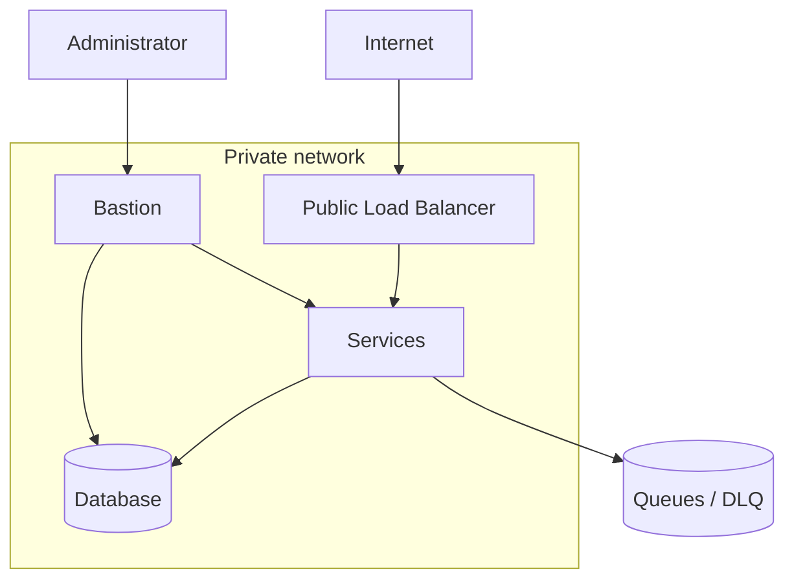

# AWS Infrastructure

**Version:** 0.1 · **Status:** Draft (GestC06) · See lab restrictions in `../management/aws-budget.md`

## 1. Environments
Two environments, **QA** and **Production**, each in its own AWS lab, created with Terraform (`../devops/terraform-and-environments.md`).

## 2. Network and security

- **Security through the load balancer:** only the load balancer is public; services and the database sit in private subnets. The services' security group only accepts traffic from the load balancer's group, and the database's only from the services'.
- **TLS** terminated at the load balancer, as long as the lab allows the certificate.
- **Bastion:** the only administrative entry point to private resources, restricted by IP and shut down when not in use. Alternative: SSM sessions, if the lab allows them.
- If the lab allows WAF, evaluate it to limit abusive requests.

## 3. Load balancer
Application load balancer with path-based routing (`/api/identity/*`, `/api/policies/*`, etc.), per-service health checks and WebSocket support.

## 4. Lambda functions
Planned uses: generating pre-signed URLs, reprocessing DLQ messages and scheduled tasks. In the labs they run with the existing role (LabRole).

## 5. Pre-signed URLs
They allow uploading or downloading a file from S3 directly, without going through the services, with a short expiry (minutes). Uses: incident evidence and exported reports. They are not used for biometric data.

## 6. n8n
Workflow automation tool deployed on a small QA instance. Planned flows: staff onboarding and offboarding (revokes credentials), alert notifications and scheduled reports. It is protected with authentication and is not exposed without control.

## 7. "OpenCore or Hermes" server
To be clarified (see `../topics-matrix.md`). It will be documented here once its role is defined.

## 8. Alternatives if a service is not available in the lab
| Need | Preferred | Alternative |
|---|---|---|
| Queues and DLQ | SQS + SNS | RabbitMQ on an instance |
| Dashboard hosting | S3 | Web server on EC2 |
| Administrative access | Bastion | SSM Session Manager |
| TLS certificates | Managed certificate | Own certificate in QA |
