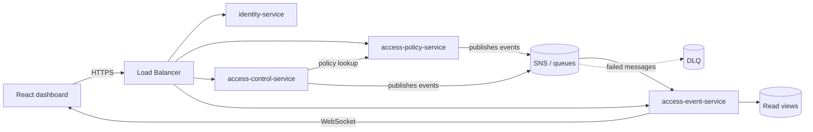

# Architecture Overview

**Version:** 0.1 · **Status:** Draft (closed in GestC03)

## 1. Principles
- **Monorepo, microservices:** one repository, independent services with clear responsibilities.
- **CQRS and events:** writes (commands) are separated from reads (views), and services communicate through events.
- **Secure by default:** the access decision denies if no rule allows it.
- **Infrastructure as code:** the whole environment in Terraform, for QA and Production.
- **Designed for a small budget:** few resources, well chosen.

## 2. Services
| Service | Responsibility |
|---|---|
| identity-service | Staff, accounts, employment status and credentials |
| access-policy-service | Roles, permissions, areas, schedules and rules (command side) |
| access-control-service | Access decision and communication with doors (simulator) |
| access-event-service | Event recording and read views for the dashboard |
| web (React + Vite) | Security dashboard, hosted on S3 |

## 3. General diagram

## 3.1 Flow of an access request
1. The door simulator sends a request with credential and door to `access-control-service`.
2. The service looks up the policy in `access-policy-service` (protected by a circuit breaker).
3. A decision is made: allowed or denied, with a reason.
4. An event is published (`access.granted` or `access.denied`).
5. `access-event-service` consumes it, updates the views and sends it to the dashboard over WebSocket.

## 4. Failure behavior
If the policy service does not respond, the default behavior is to **deny** (fail-closed), except for a short-lived policy cache and a documented emergency procedure. Recorded as ADR-0005.

## 5. Related documents
`monorepo-nx-turborepo.md`, `patterns-and-resilience.md`, `aws-infrastructure.md`, `frontend.md`, `decisions/README.md`.
